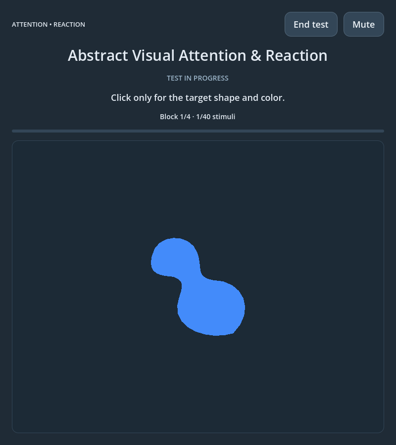

# Abstract Visual Attention & Reaction

An offline cognitive practice game built with **Godot 4.7.2** and GDScript. Practice sustained visual attention, remembering a changing target, response inhibition, and reaction speed by recognizing abstract shapes and colors.

**[Watch the YouTube demonstration](https://youtu.be/lAlAETRamKw)**



The screenshot is an unedited capture of the running application during gameplay, rendered by Godot at 800 × 900 pixels.

This application is intended for **cognitive practice and experimentation, not clinical diagnosis** or standardized clinical assessment. Its cognitive effectiveness has not been clinically validated.

## Features

- Twelve fixed abstract silhouettes in four colors: blue, yellow, pink, and green.
- Forty stimuli per session, organized into four blocks of ten.
- A new target shape/color combination every ten stimuli.
- Randomized schedules with three target appearances per block and distractors sharing just the shape or just the color.
- Reaction times, response accuracy, error counts, and persistent local history.
- Brief visual error feedback and optional interface sounds with Mute/Unmute.
- Responsive layout, a menu gallery of all twelve shapes, and no network or external runtime dependencies.

## How to play

1. Select **Start Game** and memorize the target's **shape and color** during its three-second preview.
2. Wait for the **3–2–1** countdown. Preparation clicks are ignored.
3. Click anywhere in the game window, except the menu controls, only when **both** the shape and color match the target. Ignore all other figures.
4. Each figure appears for **one second**, separated by a random blank interval of **one to four seconds**. Only the first response to each figure counts. Clicking during a blank interval is a premature response.
5. After every ten stimuli, **NEW TARGET** appears for 1.5 seconds, followed by the next target preview and countdown. The next block uses a different combination.
6. Complete all **40 stimuli in four blocks** to see your results. Select **Session history** from the menu to review the ten most recent completed sessions.

**End test** or losing window focus discards an incomplete session. Mute/Unmute is available during play. Interface actions, session start, and completion have generated audio cues; stimuli, responses, target changes, and error feedback are silent.

### The twelve abstract shapes

The menu's neutral 3 × 4 gallery shows the actual twelve outlines in library order (`abstract_01` through `abstract_12`, left to right, top to bottom). These identifiers are internal labels, not familiar object names to memorize.

The silhouettes combine compact rounded masses, elongated profiles, broad curves, angular cutouts, unequal lobes, and pointed contours. All twelve have fixed coordinates and orientation, with comparable filled areas. Curved edges use sampled cubic Bezier paths; the same polygon renderer draws both the gallery and gameplay figures. Shape and color are independent, giving **48 possible combinations**. Recognition requires the complete shape/color pair.

### Feedback and statistics

A small **red X** appears near the upper-right corner of the stimulus panel for about **400 ms** after an incorrect response: a false alarm, an omitted target, or a premature click. Feedback does not interrupt the session or change stimulus deadlines. Correct hits and correct rejections show no indicator.

Results include hits, omissions, false alarms, correct rejections, premature responses, and accuracy:

```text
Accuracy = (hits + correct rejections) / 40 × 100
```

Premature responses are counted separately. Mean, median, fastest, and slowest reaction times use **correct target responses only**, in milliseconds. Missing reaction-time values appear as a dash. Timing starts at Godot's completed-render callback and uses its monotonic microsecond clock; physical display and input latency depend on your hardware and operating system.

## Install and run

Requires **Godot 4.7.2 Standard** (GDScript; .NET is not required) and a graphics driver supporting Godot's GL Compatibility renderer. No addons, asset downloads, or package installation are required.

```bash
git clone https://github.com/domadordelvent/abstract-visual-attention-reaction.git
cd abstract-visual-attention-reaction
godot --editor --path .
```

Open `project.godot` in Godot and press **F6** for the main scene or **F5** to run the project. To launch directly:

```bash
godot --path .
```

If your executable has another name, replace `godot` in these commands. This repository contains source, not prebuilt application exports.

## Local history and independence

Completed session summaries are stored locally in `user://sessions.json`, with the most recent ten retained. On a standard Linux installation, the dedicated directory is:

```text
~/.local/share/godot/app_userdata/abstract-visual-attention-reaction/
```

Godot respects `XDG_DATA_HOME` when set. Other platforms resolve `user://` through Godot's platform-specific application data directory. Writes use a temporary file and rename; read/write problems are reported in the interface.

This application has its own settings, history, scene, scripts, theme, palette, and audio bus. It does not use the sibling Visual Attention & Reaction application's files or saved sessions. Local history, caches, and generated data are excluded from Git.

## Automated verification

Run these commands from the repository root with Godot 4.7.2 and Python 3 available:

```bash
godot --headless --path . --script tests/run.gd
godot --headless --path . --script tests/errors.gd
godot --path . --script tests/preview.gd
godot --path . --script tests/errors_preview.gd
godot --display-driver headless --audio-driver PulseAudio --path . --script tests/audio.gd
python3 tests/shape_distinction.py
python3 tests/independence.py
```

Run graphical suites sequentially on an active desktop. They use real rendering and injected mouse events, resize the window, and save diagnostic screenshots under `/tmp/abstract-*`. The audio suite requires PulseAudio or PipeWire's PulseAudio compatibility service. Test sessions write temporary history files rather than saving completed sessions into your history. The optional sibling isolation check runs when `visual-attention-reaction/` is present beside this checkout.

See [TEST_RESULTS.md](TEST_RESULTS.md) for verified results and limitations.

## License

[MIT](LICENSE).
